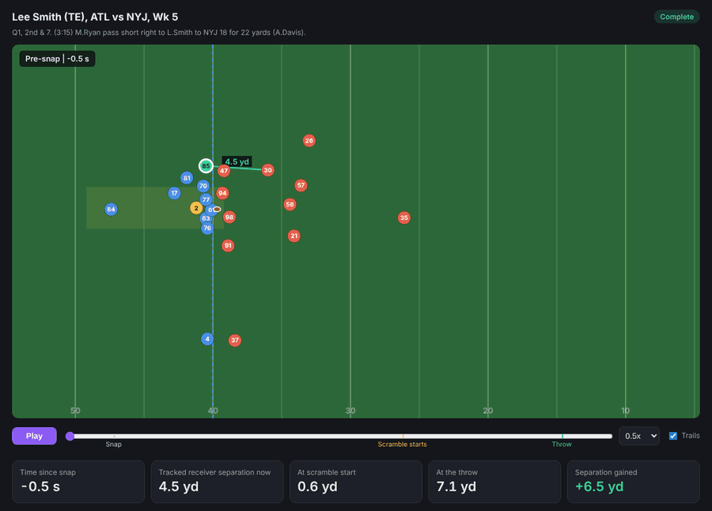

# Scramble Drill Score

When the play breaks down, which receivers keep working to get open, and does it matter?

[](https://shk8281.github.io/scramble-drill-score/)

*Lee Smith goes from 0.6 to 7.1 yds of separation during Matt Ryan's scramble. Complete, 22 yds. The green line is his gap to the nearest defender, updated 10 times a second from real tracking data.*

**Click the animation to open the interactive version** and replay any of 33 real scrambles yourself: drag the timeline, click any receiver to track him. ([backup link](https://htmlpreview.github.io/?https://github.com/shk8281/scramble-drill-score/blob/main/docs/index.html))

## TL;DR

We built a metric that measures how much separation a WR, TE, or RB gains between the moment the QB leaves the pocket and the moment he throws.

Receivers who gained 1+ yard of separation during the scramble were caught **62.7%** of the time (74 of 118). Everyone else was caught **49.1%** of the time (158 of 322).

The gap holds up after controlling for how open the receiver was when the scramble started, so it is not just open receivers being open.

Coaches can drill and grade scramble rules, scouts can compare receivers, and broadcasters can explain broken plays live.

## The insight


The payoff starts at about one yard. Receivers who gained 1 to 3 yards were caught 63.7% of the time, and those who gained more than 3 yards 60.5% (a small group of 38, so that dip is within the margin of error).

Why does "lost more than 1 yd" (51.3%) edge out "held steady" (47.8%)? Those receivers are often running backs who start the scramble wide open as checkdowns (RBs average 6.1 yds from a defender at scramble start) and are still open at the throw even after losing ground.

## Is it real, or just noise?

We tested it on 440 targeted scramble throws:

- **The gap is significant.** 62.7% vs 49.1% is a +13.6 point lift. Two-sided two-proportion z-test p = 0.011, 95% confidence interval [3.4, 23.9] points.
- **It is not just "open guys get caught."** A logistic regression of completion on separation gained, controlling for separation at scramble start and position, is highly significant (p = 0.0001). Each extra yard gained during the scramble multiplies the odds of a completion by 1.22x.

Both point the same way: receivers who keep working during a scramble are associated with more completions.

## Who gets open when the play breaks down


Among 72 receivers with 12+ scramble snaps, the top three are all wide receivers: Laviska Shenault, Courtland Sutton, and Stefon Diggs. Three of the bottom five are running backs, who start open in the flat and get run down. On average WRs gain +0.09 yds, TEs lose 0.12, and RBs lose 0.76.

## Coaching takeaway

- Receivers: keep working after the QB breaks the pocket. Gaining 1+ yard of separation during the scramble is worth about +14 completion percentage points.
- Tight ends: only 17.5% of TE targets gained a yard or more, the lowest of any position. That is the clearest room to improve.

## How we measured it

| Term | What it means |
|---|---|
| Scramble throw | Dropback tagged SCRAMBLE by PFF that ended in a pass (complete, incomplete, or INT). Designed rollouts are excluded. |
| Scramble start | First moment the QB moves more than 3 yards sideways from where he took the snap |
| Separation | Distance from the receiver to the nearest defender in coverage |
| Separation gained | Separation at the throw minus separation at scramble start |
| Target / result | Receiver named in the play description, matched by last name to a route runner on that play; result from plays.csv. Throwaways are excluded. |

Data: 2021 NFL season Weeks 1-8 Next Gen Stats tracking (10 frames/sec) + PFF scouting data; 567 scramble throws, 559 with a measurable scramble window, 440 matched targets.

## Assumptions & limitations

- Association, not causation. The QB may already be looking at the receiver who is working.
- Tracking ends 0.5s after the throw, so catch point and yards after catch are not measured; outcomes come from plays.csv.
- Scramble start is a simple 3-yard rule, not a hand-labeled moment.
- Separation uses the nearest defender, not necessarily the defender assigned to that receiver.
- Interceptions count as incompletions, and throwaways are excluded.
- The overall effect is statistically significant, but per-player rankings rest on small samples (12 to 27 scramble snaps each), so individual names are directional, not definitive.

## Run it

```bash
# 1. Get the data: copy the data/ folder from this repo into the project root
git clone https://github.com/ThompsonJamesBliss/nfl-big-data-bowl-regional-event-data

# 2. Install
python -m venv .venv
.venv/bin/python -m pip install -r requirements.txt      # Windows: .venv\Scripts\python.exe

# 3. Run the pipeline (charts, tables, results.txt in output/)
.venv/bin/python main.py

# 4. Rebuild the interactive page (docs/index.html) and play viewer
.venv/bin/python -m src.build_site
```

File map:

- `main.py`: one command, runs the pipeline and writes every chart and table.
- `src/load.py`: reads the CSVs and loads tracking for selected plays.
- `src/scramble.py`: finds scramble throws and merges PFF roles.
- `src/separation.py`: finds snap, scramble start, and throw, and computes each receiver's separation gained.
- `src/target.py`: finds the targeted receiver and attaches the play result.
- `src/charts.py`: builds the payoff chart, the leaderboard, and the statistics.
- `src/build_viewer.py`, `src/build_site.py`: build the interactive play viewer and results page.
- `docs/index.html`: the interactive results page served by GitHub Pages.
- `output/`: generated charts, tables, `results.txt`, and the showcase animation.

## Built with

Python (pandas, numpy, matplotlib, scipy, statsmodels). Developed with Kiro (project rules in `.kiro/steering/project.md`).

Data: NFL Big Data Bowl regional event data ([source](https://github.com/ThompsonJamesBliss/nfl-big-data-bowl-regional-event-data)), originally from the NFL Big Data Bowl 2023, with NFL Next Gen Stats tracking and PFF scouting data.
