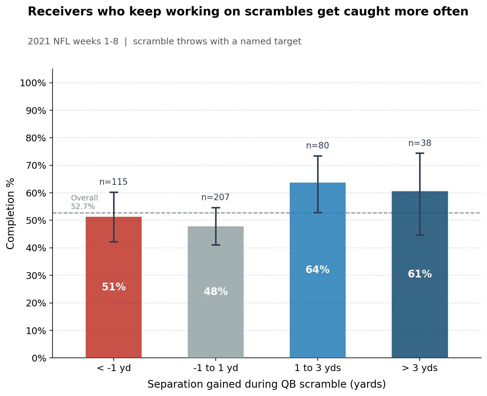
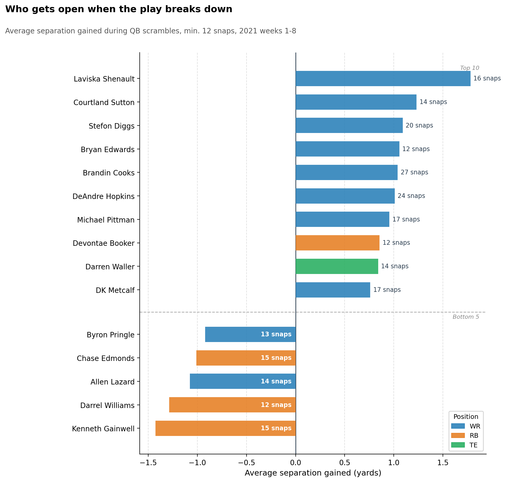

# Scramble Drill Score

**When the play breaks down, do receivers who keep working get the ball caught more often?**

An NFL Big Data Bowl entry using 2021 weeks 1-8 player tracking, PFF scouting, and play data.

## Try the interactive results

**[Open the interactive results page](https://shk8281.github.io/scramble-drill-score/)** (backup link if that one is still loading: [open via HTML preview](https://htmlpreview.github.io/?https://github.com/shk8281/scramble-drill-score/blob/main/docs/index.html))

The page has every number and chart from this project plus a **play viewer**: pick a real 2021 scramble, drag the timeline, and watch the receiver's separation from the nearest defender change frame by frame. The page source is [`docs/index.html`](docs/index.html).

---



## For coaches

When a quarterback scrambles, receivers have to improvise. This project measures whether that effort pays off.

Across 440 targeted scramble throws in 2021 weeks 1-8, receivers who gained at least one yard of separation from their nearest defender while the QB was scrambling were caught 62.7% of the time (74 of 118 targets). Receivers who did not gain that yard were caught only 49.1% of the time (158 of 322 targets). The difference is statistically meaningful (two-sided z-test, p = 0.011).

A logistic regression controlling for starting separation and position confirms the pattern: each extra yard of separation gained during the scramble is associated with 22% higher odds of a completion (odds ratio 1.22, p = 0.0001).

**Coach the scramble drill.** Receivers who gain a yard or more after the QB leaves the pocket are caught about 63% of the time vs 49%. The gap is statistically meaningful, and it gives coaches a concrete number to drill toward.

---

## Who gets open when the play breaks down



Of the 72 receivers with at least 12 scramble snaps, Laviska Shenault gained the most separation on average. Wide receivers as a group averaged +0.09 yards, tight ends -0.12 yards, and running backs -0.76 yards. Three of the five worst separators are running backs, suggesting position-specific coaching emphasis.

---

## Numbers at a glance

| Metric | Value |
|---|---|
| Scramble throws, weeks 1-8 | 567 |
| Plays with a measurable scramble window | 559 |
| Median scramble duration | 1.4 s |
| Plays with a named target | 442 |
| Plays matched to exactly one receiver | 440 |
| Completion rate, sep gained >= 1 yd | 62.7% (74/118) |
| Completion rate, sep gained < 1 yd | 49.1% (158/322) |
| Two-sided z-test p-value | 0.011 |
| sep_gained odds ratio (logistic) | 1.22 |
| Logistic p-value | 0.0001 |
| Receivers with 12+ scramble snaps | 72 |

---

## Method

**Scramble start:** The first tracking frame between snap and throw where the QB (PFF role "Pass") has moved more than 3 yards laterally from his snap position on the y-axis of the field.

**Separation:** Euclidean distance from each "Pass Route" receiver to the nearest "Coverage" defender at scramble-start and at the throw frame, computed with NumPy broadcasting. `sep_gained = sep_throw - sep_start`.

**Target:** Parsed from the play description using a regex that matches constructions like `"pass short right to T.Hill"` or `"pass incomplete deep left intended for D.Hopkins"`. Plays with no named receiver (throwaways) are excluded entirely and not counted as incompletions.

**Outcomes:** Come from `plays.csv`. Tracking ends 0.5 s after the throw so play results are never read from tracking data.

---

## How to run

```bash
# 1. Get the data
git clone https://github.com/ThompsonJamesBliss/nfl-big-data-bowl-regional-event-data
# Copy the data/ folder from that repo into this one.

# 2. Create and populate the virtual environment (Windows)
python -m venv .venv
.venv\Scripts\python.exe -m pip install -r requirements.txt

# 3. Run the full pipeline
.venv\Scripts\python.exe main.py

# 4. Rebuild the interactive results page (docs/index.html)
.venv\Scripts\python.exe -m src.build_site
```

On Mac/Linux replace `.venv\Scripts\python.exe` with `.venv/bin/python`.

All outputs land in `output/`. Printed results are also written to `output/results.txt`. The interactive page is written to `docs/index.html`, which GitHub Pages serves from the `docs/` folder. A standalone play viewer is also saved to `output/play_viewer.html`.

---

## Limitations

- Association, not causation. Receivers who keep working may be doing so because the QB is already looking their way.
- Tracking ends 0.5 s after the throw. Play outcomes (completion, interception) come from `plays.csv`, not from tracking.
- Scramble start is an estimate based on lateral displacement. Some scrambles that stay close to the pocket may be missed, designed rollouts are excluded using PFF's dropBackType.
- Throwaways are excluded. If QBs throw away more often when no receiver is open, the completion rates here overstate what coaches should expect on average.
- Eight weeks of data and roughly 440 matched targets. The overall pattern is robust, but individual player numbers are noisy.
- Interceptions are counted as incompletions.

---

## Built with Kiro

The project steering file (`.kiro/steering/project.md`) defines data conventions, PFF role spellings, and coding standards. The pipeline code in `src/` was generated and iterated with [Kiro](https://kiro.dev), an AI-powered development environment.

---

## Data credit

- **NFL Big Data Bowl** regional event data via [ThompsonJamesBliss/nfl-big-data-bowl-regional-event-data](https://github.com/ThompsonJamesBliss/nfl-big-data-bowl-regional-event-data), originally from the NFL Big Data Bowl 2023
- **NFL Next Gen Stats** player tracking
- **Pro Football Focus (PFF)** scouting grades and role assignments
