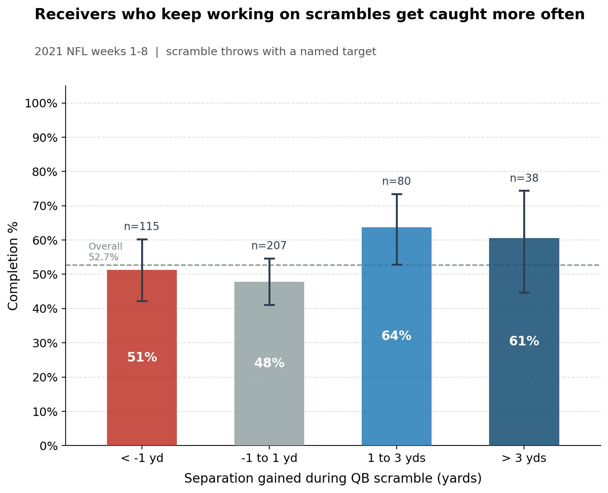
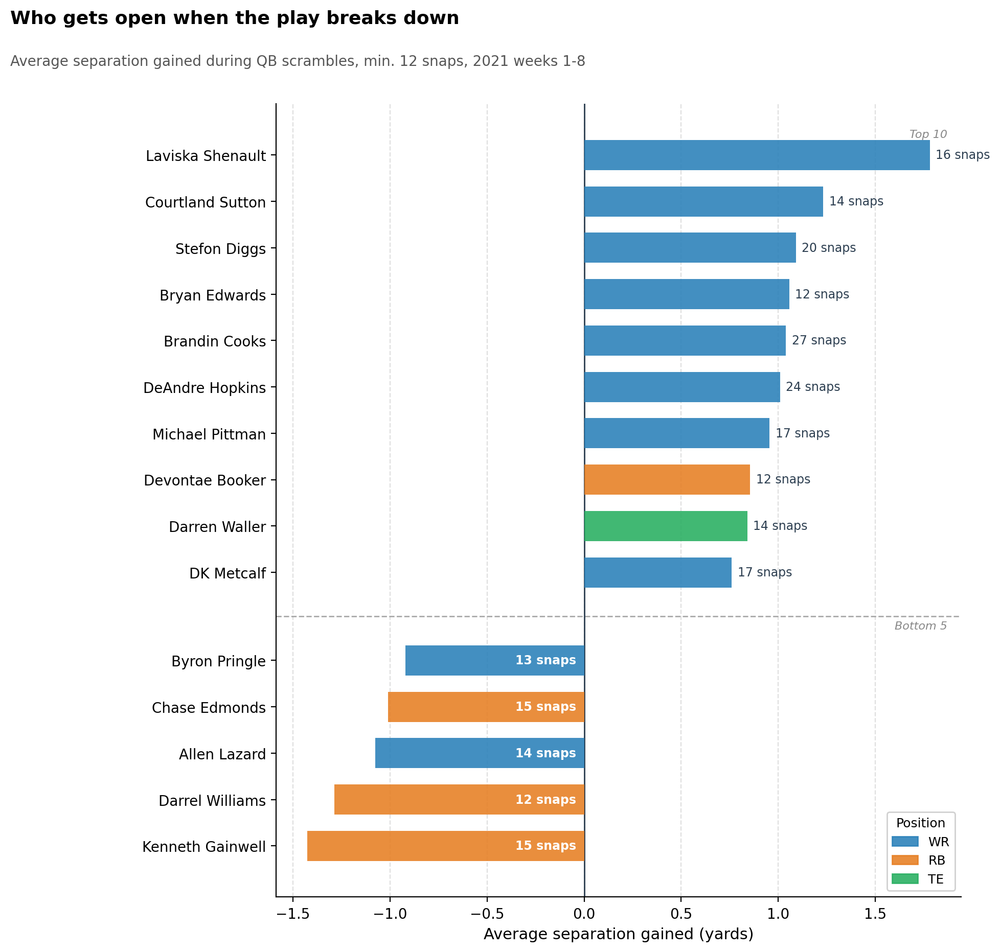

# Scramble Drill Score: Results

**Question:** When the QB scrambles, does it pay for receivers to keep working to get open?

**Answer:** Yes. Receivers who gain a yard or more of separation after the QB leaves the pocket are caught **62.7%** of the time, compared with **49.1%** for everyone else.

Data: NFL Big Data Bowl regional event data, 2021 weeks 1-8 (Next Gen Stats tracking at 10 frames per second, PFF scouting roles, plays.csv outcomes).

---

## Headline numbers

| Metric | Value |
|---|---|
| Scramble throws (dropBackType contains SCRAMBLE, pass C/I/IN) | 567 |
| Plays with a measurable scramble window | 559 |
| Median scramble length (QB leaves pocket to throw) | 1.4 s |
| Plays with a named target | 442 |
| Throwaways with no named target (excluded) | 117 |
| Targets matched to exactly one receiver | 440 |
| Completion, gained 1+ yd during scramble | **62.7%** (74 of 118) |
| Completion, gained less than 1 yd | **49.1%** (158 of 322) |
| Two-sided z-test p-value | 0.011 |
| Logistic regression odds ratio per yard gained | 1.22 (p = 0.0001) |
| Receivers on leaderboard (12+ scramble snaps) | 72 |

The logistic regression controls for the receiver's separation when the scramble started and for his position. Each extra yard gained during the scramble is associated with about 22% higher odds of a completion.

---

## Chart 1: Separation gained pays off

| Separation gained during scramble | Targets | Completions | Completion % | 95% interval |
|---|---|---|---|---|
| Lost more than 1 yd | 115 | 59 | 51.3% | 42% to 60% |
| -1 to +1 yd | 207 | 99 | 47.8% | 41% to 55% |
| Gained 1 to 3 yds | 80 | 51 | 63.7% | 53% to 73% |
| Gained more than 3 yds | 38 | 23 | 60.5% | 45% to 74% |

The jump happens at about 1 yard. The "more than 3 yards" group is small (38 targets), so its dip is within the margin of error.

---

## Chart 2: Who gets open when the play breaks down

---

## By position

| Position | Receiver snaps | Avg separation at scramble start | Avg separation at throw | Avg gained | Targets | Completion % | Share of targets that gained 1+ yd |
|---|---|---|---|---|---|---|---|
| WR | 1,512 | 3.07 yd | 3.16 yd | +0.09 yd | 277 | 53.8% | 31.0% |
| TE | 589 | 3.66 yd | 3.54 yd | -0.12 yd | 103 | 49.5% | 17.5% |
| RB | 454 | 6.06 yd | 5.30 yd | -0.76 yd | 59 | 54.2% | 23.7% |

RBs start the scramble wide open (often as checkdowns) and lose the most ground as defenders rally. TEs are the least likely to create new separation.

---

## Takeaways

- **Coaches:** Drill scramble rules. A receiver who works for one more yard after the QB breaks the pocket turns a coin-flip throw into a likely completion.
- **Broadcasters:** "Separation gained on the scramble" is an easy on-screen stat. Laviska Shenault (+1.78 yd), Courtland Sutton and Stefon Diggs lead the group.
- **Scouts:** The leaderboard separates receivers who improvise well from those who stall. Use it alongside film, since samples are 12 to 27 snaps per player.

---

## Method

1. **Scramble start:** first frame between snap and throw where the QB (PFF role "Pass") is more than 3 yards sideways from his snap position.
2. **Separation:** distance from each "Pass Route" receiver to the nearest "Coverage" defender, at scramble start and at the throw. Gained = throw minus start.
3. **Target:** parsed from the play description ("to T.Hill", "intended for D.Hopkins") and matched by last name to a route runner on that play.
4. **Outcome:** completion from plays.csv. Interceptions count as incompletions.

## Limitations

- Association, not causation. The QB may already be looking at the receiver who is working.
- Tracking ends 0.5 s after the throw, so outcomes come from plays.csv.
- The 3-yard sideways rule is an estimate of when the scramble starts.
- Throwaways are excluded, which may slightly overstate completion rates.
- Eight weeks and 440 targets: the team-wide result is solid, player numbers are noisy.

---

<b>Full leaderboard: all 72 receivers with 12+ scramble snaps</b>

| Rank | Player | Pos | Scramble snaps | Avg separation gained |
|---|---|---|---|---|
| 1 | Laviska Shenault | WR | 16 | +1.78 |
| 2 | Courtland Sutton | WR | 14 | +1.23 |
| 3 | Stefon Diggs | WR | 20 | +1.09 |
| 4 | Bryan Edwards | WR | 12 | +1.06 |
| 5 | Brandin Cooks | WR | 27 | +1.04 |
| 6 | DeAndre Hopkins | WR | 24 | +1.01 |
| 7 | Michael Pittman | WR | 17 | +0.95 |
| 8 | Devontae Booker | RB | 12 | +0.86 |
| 9 | Darren Waller | TE | 14 | +0.84 |
| 10 | DK Metcalf | WR | 17 | +0.76 |
| 11 | Elijah Moore | WR | 13 | +0.74 |
| 12 | Rondale Moore | WR | 15 | +0.71 |
| 13 | Marvin Jones | WR | 21 | +0.66 |
| 14 | Dawson Knox | TE | 14 | +0.65 |
| 15 | Greg Ward | WR | 13 | +0.59 |
| 16 | A.J. Green | WR | 26 | +0.56 |
| 17 | Freddie Swain | WR | 20 | +0.50 |
| 18 | Keenan Allen | WR | 14 | +0.43 |
| 19 | Mark Andrews | TE | 16 | +0.32 |
| 20 | Jalen Guyton | WR | 13 | +0.31 |
| 21 | J.D. McKissic | RB | 13 | +0.31 |
| 22 | Amari Cooper | WR | 14 | +0.28 |
| 23 | Zach Ertz | TE | 21 | +0.25 |
| 24 | Dallas Goedert | TE | 21 | +0.24 |
| 25 | Quez Watkins | WR | 25 | +0.21 |
| 26 | Hunter Renfrow | WR | 15 | +0.17 |
| 27 | DeVonta Smith | WR | 36 | +0.15 |
| 28 | Emmanuel Sanders | WR | 21 | +0.14 |
| 29 | Adam Humphries | WR | 16 | +0.13 |
| 30 | Robby Anderson | WR | 18 | +0.13 |
| 31 | Devin Duvernay | WR | 13 | +0.12 |
| 32 | Allen Robinson | WR | 12 | +0.10 |
| 33 | Travis Kelce | TE | 27 | +0.09 |
| 34 | Terry McLaurin | WR | 21 | +0.09 |
| 35 | Cole Beasley | WR | 16 | +0.08 |
| 36 | Christian Kirk | WR | 21 | +0.08 |
| 37 | Chris Conley | WR | 18 | +0.07 |
| 38 | Davante Adams | WR | 15 | +0.07 |
| 39 | DeVante Parker | WR | 14 | -0.02 |
| 40 | Jaylen Waddle | WR | 17 | -0.08 |
| 41 | Jamal Agnew | WR | 13 | -0.10 |
| 42 | Adam Thielen | WR | 14 | -0.11 |
| 43 | Mike Williams | WR | 12 | -0.12 |
| 44 | Corey Davis | WR | 18 | -0.14 |
| 45 | Ricky Seals-Jones | TE | 15 | -0.20 |
| 46 | Darnell Mooney | WR | 12 | -0.24 |
| 47 | Jordan Akins | TE | 18 | -0.27 |
| 48 | Gerald Everett | TE | 14 | -0.28 |
| 49 | Tyreek Hill | WR | 30 | -0.29 |
| 50 | Demarcus Robinson | WR | 22 | -0.32 |
| 51 | Zach Pascal | WR | 17 | -0.32 |
| 52 | Tim Patrick | WR | 14 | -0.38 |
| 53 | Jalen Reagor | WR | 28 | -0.39 |
| 54 | Marquise Brown | WR | 18 | -0.41 |
| 55 | CeeDee Lamb | WR | 12 | -0.43 |
| 56 | Jared Cook | TE | 13 | -0.46 |
| 57 | Noah Fant | TE | 13 | -0.48 |
| 58 | Tyler Lockett | WR | 20 | -0.48 |
| 59 | Mike Gesicki | TE | 15 | -0.49 |
| 60 | Evan Engram | TE | 14 | -0.55 |
| 61 | Mecole Hardman | WR | 17 | -0.57 |
| 62 | T.J. Hockenson | TE | 12 | -0.62 |
| 63 | Jamison Crowder | WR | 12 | -0.67 |
| 64 | David Johnson | RB | 12 | -0.72 |
| 65 | Robert Tonyan | TE | 13 | -0.79 |
| 66 | D.J. Moore | WR | 19 | -0.82 |
| 67 | Justin Jefferson | WR | 14 | -0.85 |
| 68 | Byron Pringle | WR | 13 | -0.92 |
| 69 | Chase Edmonds | RB | 15 | -1.01 |
| 70 | Allen Lazard | WR | 14 | -1.08 |
| 71 | Darrel Williams | RB | 12 | -1.29 |
| 72 | Kenneth Gainwell | RB | 15 | -1.43 |

